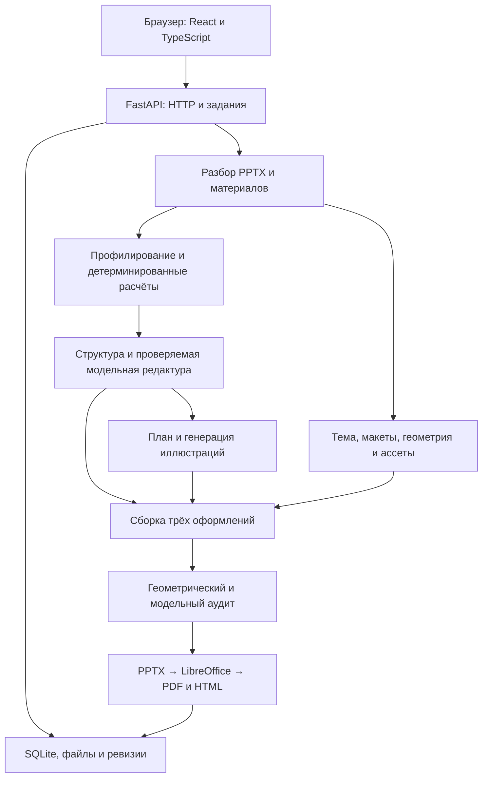

# Цифровой дизайнер презентаций — документация решения

Итоговое описание продукта, архитектуры, алгоритмов и эксплуатации. Подготовлено
для экспертов финала VK Tech, актуализировано 20 октября 2026 года.

**Репозиторий:** [DiFoxenGit/-VKTechHackathon](https://github.com/DiFoxenGit/-VKTechHackathon).
**Основной стенд:** http://158.160.225.35/ .
**Дополнительный стенд:** https://auto-sell.site/presentations/ .

## Содержание

1. [Назначение и возможности](#1-назначение-и-возможности)
2. [Пользовательский сценарий](#2-пользовательский-сценарий)
3. [Архитектура и стек](#3-архитектура-и-стек)
4. [Шаблоны и автоматическая вёрстка](#4-шаблоны-и-автоматическая-вёрстка)
5. [Данные, расчёты и содержание](#5-данные-расчёты-и-содержание)
6. [Модели и изображения](#6-модели-и-изображения)
7. [Аудит, редактор и экспорт](#7-аудит-редактор-и-экспорт)
8. [Запуск и настройка](#8-запуск-и-настройка)
9. [API и хранение](#9-api-и-хранение)
10. [Развёртывание и эксплуатация](#10-развёртывание-и-эксплуатация)
11. [Проверки и результаты](#11-проверки-и-результаты)
12. [Ограничения и развитие](#12-ограничения-и-развитие)
13. [Карта документации](#13-карта-документации)

## 1. Назначение и возможности

Сервис превращает бриф и исходные материалы в презентацию внутри заданного
PPTX-шаблона. Он автоматизирует подготовку содержания, расчёты по таблицам,
подбор визуализаций и ассетов, компоновку страниц и проверку результата.

Основные сценарии — защита инициативы, представление продукта или проекта,
управленческий отчёт по данным. Пользователю не требуется вручную переносить
показатели из CSV в таблицы и диаграммы PowerPoint.

| Возможность | Результат для пользователя |
| --- | --- |
| Импорт произвольного PPTX | Использование темы, макетов, геометрии и визуальных элементов исходного шаблона |
| Материалы и визуальный пак | Тексты, таблицы, изображения и иконки участвуют в содержании и оформлении |
| Проверяемая аналитика | Числа вычисляются программно и связаны с исходными строками |
| Модельная редактура | Структура, выводы и действия проходят проверку схемы и защищённых фактов |
| Три оформления | `classic`, `split`, `focus` для одного содержания; общий запуск трёх шаблонов даёт девять колод |
| Новые изображения | Планирование и генерация иллюстраций с явными статусами и ограничениями бюджета |
| Аудит и правки | Координаты замечаний, выбор безопасных исправлений, новая ревизия и возврат версии |
| Экспорт | Редактируемые объекты PPTX, PDF для отправки и автономный HTML |

Исходные документы рассматриваются как данные, а не как команды, управляющие
системой. Сведения из материалов не дают модели права менять правила проверки.

## 2. Пользовательский сценарий

1. Ввести тему, адресата и задачу презентации, выбрать количество страниц и шаблон.
2. Загрузить материалы. Визуальный ZIP-пак можно приложить вместе с текстами и таблицами.
3. Для управленческого отчёта указать периоды, условия и файл контекста; проверить данные.
4. При необходимости загрузить брендбук и включить создание новых изображений.
5. Запустить генерацию одного шаблона или общий запуск трёх шаблонов.
6. Дождаться результата и готового серверного предпросмотра. Посмотреть оформление,
   фактическую модель, расчёты, источники и статусы иллюстраций.
7. Отредактировать допустимое содержание, сохранить изменения, выполнить нужные проверки
   и выбрать исправления. Защищённые аналитические факты меняются через источники и пересчёт.
8. Скачать нужную ревизию в PPTX/PDF/HTML. Список проектов сохраняется в браузере,
   сами документы и ревизии — на сервере.

### Воспроизводимый полный пример

Бриф: [samples/final-demo/business-brief.txt](../samples/final-demo/business-brief.txt).
Он задаёт 13 страниц: обложка и 12 аналитических страниц, две новые иллюстрации,
редактируемые графики и таблицы, подтверждённые выводы и действия с ограничениями.

| Материал | Путь в репозитории |
| --- | --- |
| Продажи, план и контекст | `samples/business-acceptance/period-context-v1/baseline/`: `sales.csv`, `plan.csv`, `context.txt` |
| Справочники и визуальный пак | `samples/business-acceptance/data-v1/`: `products.csv`, `regions.csv`, `content-pack.zip` |
| Периоды | `samples/business-acceptance/period-context-v1/settings.json` |
| Условия, цитаты и ограничения | `samples/business-acceptance/period-context-v1/baseline/conditions.json` |

Загрузить шесть материалов, отдельно импортировать периоды и условия, выбрать
`context.txt` как источник контекста. В общем запуске явно выбрать Education,
WorkSpace и Tech: на стенде могут присутствовать дополнительные шаблоны.

Это синтетический набор: 1512 строк продаж, 288 строк плана, справочники и
управленческий контекст. Он не выдаётся за реальные продажи компании. Демонстрационный
брендбук из `samples/final-design/brandbook.json` необязателен: для показа исходного
дизайна организаторских шаблонов его загружать не нужно.

## 3. Архитектура и стек



| Слой | Технологии и ответственность |
| --- | --- |
| Интерфейс | React 19, TypeScript, Vite, Lucide; материалы, параметры, прогресс, редактор, аудит, экспорт |
| API и схемы | Python 3.11, FastAPI, Pydantic, Uvicorn; контракты, валидация, очередь и статусы |
| PowerPoint | `python-pptx`, OOXML; разбор, перенос оформления, нативные фигуры, таблицы и диаграммы |
| Данные | CSV/JSON, `openpyxl`, Decimal; импорт, профилирование, точные денежные расчёты |
| Рендер | LibreOffice, PDFium, Pillow, fontTools; PDF, превью, работа со шрифтами и изображениями |
| Модели | `httpx`, OpenAI-совместимый транспорт, отдельные адаптеры GenAPI |
| Хранение | SQLite для записей, файловые каталоги для исходников и экспортов, Docker volume |
| Поставка | Docker Compose, GitHub Actions, reverse proxy на стендах |

Границы модулей:

- `backend/designer/app.py` — HTTP, задания и оркестрация; `pipeline.py` — сборочный пайплайн.
- `parsing.py`, `layout.py`, `assets.py`, `analytics_layout.py` — шаблон, композиция и визуальные объекты.
- `analytics/` — импорт, вычисления, доказательства и бизнес-история.
- `algorithms/` — отбор контекста, проверки содержания и баланс текста.
- `ai.py`, `text_genapi.py`, `image_genapi.py`, `ai_audit.py` — обращения к моделям.
- `audit.py`, `exporting.py`, `storage.py` — проверки, файлы и сохранение.
- `frontend/src/services/presentationService.ts` — контракт интерфейса с API.

Подробности: [алгоритмы и границы модулей](algorithm-pipeline.md).

## 4. Шаблоны и автоматическая вёрстка

При импорте PPTX извлекаются палитра и тема, шрифты и размеры, геометрия страниц,
текстовые слоты, макеты, направляющие, фон, изображения, логотипы и колонтитулы.
Страницы классифицируются по роли: обложка, содержание, раздел, завершение.
При наличии рендера дополнительно оценивается фон.

Содержание сопоставляется с подходящим прототипом. Компоновщик выбирает рабочую
область, учитывает занятое декором пространство, подгоняет текст и размещает
визуализацию. Сохраняется происхождение использованных ассетов. SVG может
превращаться в редактируемые фигуры; растровые изображения вставляются с сохранением пропорций.

`classic`, `split` и `focus` меняют композицию, но не исходные показатели. Это не
три независимых текста. Конкретное расположение зависит от возможностей шаблона.

Для неизвестных шаблонов реализованы общие правила: безопасный выбор доступного
шрифта с кириллицей, распознавание обложки по композиции, обработка тёмного фона,
адаптация внутренних разделителей, размещение картинок и нестандартных заметок.
Названия файлов не используются как переключатель специальных правил.

Явно загруженный брендбук имеет приоритет и может заменить фон, цвета и шрифты
исходника. В этом режиме нельзя одновременно обещать полное сохранение исходного
декора. Образцы цвета старого фона не используются для расчёта контраста нового.

## 5. Данные, расчёты и содержание

### Общая аналитика

Табличные данные хранятся полностью, отдельно от ограниченного контекста LLM.
`AnalysisResult` связывает профиль данных, операцию, результат, факты и доказательства:
файл, лист/таблицу, строки и колонки. Пропуск не подменяется нулём, выбросы не удаляются
молча, единицы измерения не выдумываются. Неоднозначный вход может дать отказ с причиной.

Визуализация выбирается по структуре данных и задаче: динамика, сравнение, доли,
отклонения, точное сопоставление в таблице. Если допустима только таблица, сервис
не добавляет график ради количества. Формулы XLSX не пересчитываются: используются
сохранённые результаты с предупреждением при их отсутствии.

### Управленческий бизнес-кейс

Специализированный контракт задаёт ключи продаж, плана и справочников, валюту,
отчётный и сравнительные периоды. В денежной арифметике используется Decimal.

```text
Чистая выручка = выручка до корректировок − скидки − возвраты
Валовая прибыль = чистая выручка − себестоимость
Валовая маржа = валовая прибыль / чистая выручка × 100 %
```

Также рассчитываются изменения по периодам, план-факт, вклад продуктов и регионов,
экономика каналов и доля возвратов. Нулевой знаменатель обрабатывается явно.
Нельзя автоматически приписать каналам план, в котором нет измерения «канал».

Контекст задаёт подтверждённые цитатами условия: бюджет, ресурсы, владельцев,
сроки и критерии действий. Система разделяет рассчитанное наблюдение, интерпретацию,
гипотезу о причине и предлагаемое действие. Она не обещает доказанный эффект инвестиций
по одной лишь корреляции показателей.

Модель редактирует формулировки в пределах проверенных фактов. Числа, периоды,
источники и действия валидируются после ответа. Смысловые роли передаются как
структурированные блоки, а не выводятся из пунктуации заголовка. Изменение источника
или периода требует пересчёта и новой истории, а не правки одного числа в слайде.

Контракты: [общая аналитика](analytics-contract.md), [бизнес-данные](business-data-contract.md),
[периоды и контекст](business-periods-context.md).

## 6. Модели и изображения

| Роль | Реализация |
| --- | --- |
| Структура и редактура | Основной финальный профиль VK `qwen38-27b-fp8`; другой OpenAI-совместимый профиль можно задать окружением |
| Текстовый резерв | Явно включаемая GenAPI `gemma-4-31b`, с отдельным ключом и тем же валидатором |
| Новые иллюстрации | GenAPI Z-Image либо настроенный OpenAI-совместимый image endpoint |
| Работа с изображением | Отдельная VLM для поддерживаемых проверок и описания ассетов; доступность зависит от конфигурации |

Версии промптов и их соответствие ролям заданы в `backend/designer/prompts/manifest.json`.
`GET /api/v1/workflow` возвращает сведения о сценарии и контрольных суммах промптов.
Версия манифеста не заменяет SHA коммита приложения.

Ответ LLM проходит разбор JSON, проверку схемы и проверку содержания. Неверный ответ
получает ограниченную обратную связь. Транспортный сбой VK может переключить запрос
на настроенный резерв; после повторной ошибки схемы/фактов последняя попытка существующего
бюджета также может использовать резерв. Успешный ответ VK резерв не вызывает.
Истёкшее ожидание уже принятого платного задания не означает разрешения повторно отправить POST.

План иллюстраций определяет количество, страницы, сюжет, стиль и сторону размещения.
Готовый план проверяется на допустимость и бюджет. Цвета передаются понятными словами,
чтобы технические RGB-коды не становились надписями в рисунке. Картинки не заменяют
нативные аналитические графики и переиспользуются между оформлениями.

Интерфейс сохраняет статусы создания и проверки изображения. `visible_text_only`
означает поиск видимого текста, а не оценку всей композиции. `unavailable` или `failed`
не превращаются в успешную проверку из-за наличия PNG. Фактический provider/model и
журнал вызовов важнее названия настроенного профиля.

Настройка: [резерв](vk-genapi-fallback.md), [GenAPI Images](genapi-images.md),
[план иллюстраций](model-image-plan.md), [устойчивость вызовов](model-recovery-and-history-api-2026-10-20.md).

## 7. Аудит, редактор и экспорт

Детерминированный аудит проверяет геометрию, выход за страницу, наложения,
поля, типографику, плотность, палитру и контраст, целостность файла и часть
проверок содержания. Модельный текстовый аудит проверяет смысл, источники,
заголовки и связность; визуальный режим требует отдельного работающего VLM-профиля.

Находка содержит код, слайд, пояснение, категорию, серьёзность и, если определены,
координаты области. Пользователь выбирает конкретные безопасные исправления.
Содержательные проблемы без безопасного преобразования остаются ручными.

Каждое изменение создаёт ревизию. Запрос со старой ревизией отклоняется с HTTP 409.
Отмена геометрического исправления возвращает состояние страницы и сохраняет
смысловые предупреждения. После изменения содержания старый модельный отчёт
не считается новой проверкой изменённого текста.

Предпросмотр серверной ревизии строится по фактическому экспорту. Редактор ожидает
загрузки и декодирования обложки; у параллельных заданий независимый прогресс.
Несохранённые правки обозначаются явно. После сохранения обновляется серверная версия.

| Формат | Что получает пользователь |
| --- | --- |
| PPTX | Редактируемые тексты, фигуры, таблицы и диаграммы с данными; иллюстрации остаются изображениями |
| PDF | Рендер соответствующего PPTX через LibreOffice |
| HTML | Автономная страница, собранная из PDF-рендера; не равна нативно редактируемому PPTX |

Полное соответствие проверок Приложению 1 и ограничения: [AUDIT.md](../AUDIT.md).

## 8. Запуск и настройка

### Рекомендуемый запуск через Docker

Требуются Git и Docker с Compose. Команды выполняются из корня репозитория:

```bash
git clone https://github.com/DiFoxenGit/-VKTechHackathon.git
cd ./-VKTechHackathon
cp .env.example .env
mkdir -p templates
```

Заполнить выбранный профиль модели в локальном `.env`. Исходные организаторские
PPTX не включены в публичный репозиторий: положить доступные файлы в `templates/`
или импортировать собственный шаблон через интерфейс/API.

```bash
docker compose up --build -d
docker compose ps
curl http://localhost:8000/health
```

Интерфейс: http://localhost:3000/ . API: http://localhost:8000/api/v1 .
Swagger включается через `DESIGNER_DOCS=1` и доступен на `/docs`.
Без настроенного провайдера нельзя заявлять работоспособность модельной генерации;
для детерминированной сборки API поддерживает готовый `outline`.

### Основные переменные

| Назначение | Переменные |
| --- | --- |
| Профиль текста | `DESIGNER_LLM_PROVIDER=openai` или `vk` |
| Совместимый текстовый endpoint | `DESIGNER_LLM_BASE_URL`, `DESIGNER_LLM_MODEL`, `DESIGNER_LLM_API_KEY` |
| Выданный VK-профиль | `DESIGNER_VK_BASE_URL`, `DESIGNER_VK_MODEL`, `DESIGNER_VK_API_KEY`, `DESIGNER_VK_PROJECT_ID` |
| Текстовый резерв | `DESIGNER_FALLBACK_PROVIDER=genapi`, `DESIGNER_FALLBACK_MODEL`, `DESIGNER_FALLBACK_API_KEY` |
| Генерация изображений | `DESIGNER_IMAGE_PROVIDER`, `DESIGNER_IMAGE_MODEL`, `DESIGNER_IMAGE_API_KEY`, при необходимости `DESIGNER_IMAGE_BASE_URL` |
| Проверки изображений | `DESIGNER_VLM_MODEL`, `DESIGNER_VLM_BASE_URL`, `DESIGNER_VLM_API_KEY` |
| Доступ и браузер | `DESIGNER_API_KEY`, `DESIGNER_CORS_ORIGINS`, `DESIGNER_DOCS` |
| Ограничения | `DESIGNER_LLM_ATTEMPTS`, тайм-ауты профилей, `DESIGNER_MAX_JOBS`, `DESIGNER_IMAGE_LIMIT` |

Адрес, модель и доступ VK берутся из выданной инструкции, а не подбираются по догадке.
Текстовый резерв GenAPI настраивается отдельно; image-профилю GenAPI нужен отдельный
image-ключ. Отключение роли должно отражаться понятным статусом в интерфейсе.
Секреты не коммитятся и не вставляются в бриф или журналы.

Полный шаблон параметров: [.env.example](../.env.example). Запуск без Docker и
подробности серверной установки: [deploy.md](deploy.md).

## 9. API и хранение

Основной префикс — `/api/v1`. На auto-sell — `/presentations/api/v1`.
Использовать возвращённые `status_url` и `exports`, учитывающие префикс стенда.
При включённом `DESIGNER_API_KEY` нужен `Authorization: Bearer <token>`.

| Операция | Метод и путь относительно `/api/v1` |
| --- | --- |
| Список / импорт шаблона | `GET /templates`, `POST /templates` |
| Загрузка материалов / брендбука | `POST /content-packs`, `POST /brandbooks` |
| Анализ / структура | `POST /analysis`, `POST /outlines` |
| Один шаблон / общий запуск | `POST /generations`, `POST /generation-batches` |
| Статус задания | `GET /jobs/{id}` |
| История / документ | `GET /presentations?offset=0&limit=50`, `GET /presentations/{id}` |
| Сохранение | `PATCH /presentations/{id}` или `/presentations/{id}/slides/{index}` |
| Аудит | `GET` / `POST /presentations/{id}/audit`; режимы `contextual` и `visual` |
| Выбранные исправления | `POST /presentations/{id}/fixes` с `revision` и `issue_ids` |
| Возврат версии | `POST /presentations/{id}/revisions/{target_revision}/restore` |
| Повтор иллюстраций | `POST /presentations/{id}/illustrations/retry` |
| Экспорт | `GET /presentations/{id}/export/{pptx|pdf|html}?revision=…` |

Общий запуск принимает `requests` с параметрами отдельных генераций, возвращает
batch ID и задания. Браузер опрашивает задания до `completed`/`failed`, затем
получает документы. Пакетный механизм может переиспользовать одну проверенную
редактуру на совместимых входах; происхождение общего текста сохраняется в журнале.

Примеры тел запросов, моделей Visual и ошибок: [API.md](API.md).
Актуальная схема генерируется приложением на `/openapi.json`, когда документация включена.

Записи шаблонов, источников, заданий, документов и ревизий находятся в SQLite.
Исходные файлы и экспорты — в каталогах соответствующих идентификаторов. В Docker
данные сохраняются в volume `designer-data`. История выбирается через SQL
COUNT/LIMIT/OFFSET с исключением тяжёлых полей до декодирования JSON; полный
документ, источники и доказательства остаются доступны отдельным запросом.

## 10. Развёртывание и эксплуатация

CI проверяет backend, frontend и интеграционный регресс с LibreOffice. Только после
успеха этих этапов один проверенный SHA доставляется на два стенда. Для среды
развёртывания исключён одновременный запуск двух деплоев.

Преддеплойный скрипт создаёт согласованную резервную копию SQLite и отказывается
перезапускать сервис при активных заданиях. Диагностика показывает безопасные
метаданные и статусы API, не содержимое материалов и не ключи.

Минимальная эксплуатационная проверка: `/health`, список шаблонов, ограниченная
страница истории и наличие нужной ревизии. `llm_configured=true` означает наличие
настроек, а не доказательство свежего успешного ответа внешней модели.

Не удалять volume при обычном обновлении. Установка и откат, reverse proxy,
секреты CI и отдельный префикс auto-sell описаны в [deploy.md](deploy.md),
[dual-stand-deploy.md](dual-stand-deploy.md) и [autosell.md](autosell.md).

## 11. Проверки и результаты

Проверки охватывают схемы и расчёты, защиту фактов, поведение резервов и очереди,
вёрстку и типографику, нативные объекты Office, ревизии, аудит, интерфейс и сборку.
Интеграционный регресс использует синтетические светлый 16:9 и тёмный 4:3 шаблоны;
организаторские и внешние шаблоны проверяются отдельно.

```bash
python -m pip install -r backend/requirements.txt pytest
cd backend
pytest -q
```

Для полной проверки экспорта нужны LibreOffice и доступные шрифты. Frontend из
своей папки: `npm ci`, `npm test`, `npm run build`. Это команды проверок, а не
инструкция запускать новые платные модели. Живые прогоны вынесены в отдельные инструменты.

### Подтверждённые результаты финала

- Последний код финализации `566fabd` прошёл [CI с обоими деплоями](https://github.com/DiFoxenGit/-VKTechHackathon/actions/runs/39484491891).
- В записанном бизнес-сценарии получены девять результатов на VK `qwen38-27b-fp8`,
  по 13 страниц и две новые картинки в каждой колоде. Часть результатов использует
  общую редактуру — это не девять независимых запросов модели.
- В скачанных PPTX/PDF проверены 15 независимых числовых контролей, пять нативных
  диаграмм, две таблицы, заголовки и KPI; оба новых изображения найдены по хешу в PPTX.
- Время готовности девяти колод в этом конкретном дубле — 65,08 с; PDF-конвертация
  не входит в замер. Это не универсальный SLA для произвольных входов.
- Отдельно проверены Microsoft, AWS Dark и Duomi 4:3 в трёх оформлениях, сохранение,
  повторное открытие и экспорты; обнаруженные дефекты исправлялись общими правилами.
- Сценарий смыслового аудита на явно дефектной тестовой копии подтвердил выборочную
  правку геометрии, сохранность фактов и смысловых замечаний при возврате версии.

Проверки сохранённых результатов не называются новой генерацией на текущем коммите.
Failed-отчёты прежних попыток сохраняют исходный статус. Контроль структуры PPTX
не заменяет просмотр: невидимая обложка была найдена вручную и закрыта регрессией.

Доказательства: [итоговый отчёт](final-delivery-2026-10-20.md),
[машинная сводка](final-delivery-evidence-2026-10-20.json),
[неизвестные шаблоны](unseen-template-review-2026-10-20.md), [регресс](regression.md).

## 12. Ограничения и развитие

- Поддержка различных PPTX не означает идеальную адаптацию любого повреждённого,
  экзотического или полностью растрового шаблона. Проверять исходный файл и экспорт.
- Типографические оценки приближённые. Доступность шрифта, язык и особенности
  PowerPoint/LibreOffice могут влиять на переносы; финальный просмотр необходим.
- Бизнес-адаптер работает по опубликованному контракту, не угадывает валюты,
  соединения таблиц, причинность и недостающие измерения произвольного набора.
- XLSX-формулы не вычисляются; скан без текстового слоя не равен поддержанному
  текстовому PDF. Для загрузок и архивов действуют ресурсные ограничения.
- Аудит модели не гарантирует обнаружение всех ошибок. Проверка надписей на
  изображении не подтверждает релевантность, композицию и отсутствие иных дефектов.
- Очередь находится внутри процесса; прерванные перезапуском задания отмечаются
  как interrupted/failed, а не автоматически продолжаются во внешнем брокере.
- Публичный демонстрационный режим не является многопользовательской платформой
  с изоляцией учётных записей. Список проектов браузера и серверная история — разные уровни.
- Внешние модели имеют задержки, квоты и сбои. Повторы ограничены; фактический
  провайдер и отсутствие результата должны отражаться честно.

Дальнейшее развитие: внешняя очередь с восстановлением, изоляция пользователей,
более точные измерения текста, расширение датаконтрактов и автоматизация визуальной
приёмки. Эти направления не выдаются за уже реализованные возможности.

## 13. Карта документации

| Документ | Для чего читать |
| --- | --- |
| [Корневой README](../README.md) | Краткое описание, запуск и структура репозитория |
| [Алгоритмы](algorithm-pipeline.md) | Границы модулей, проверки и применение ИИ |
| [API](API.md) | HTTP-контракты, запросы и объекты |
| [Развёртывание](deploy.md), [два стенда](dual-stand-deploy.md) | Серверная установка, поставка и откат |
| [Данные](business-data-contract.md), [периоды](business-periods-context.md) | Бизнес-семантика, проверки, происхождение фактов |
| [Аудит](../AUDIT.md) | Проверки Приложения 1, коды находок, возможности исправления |
| [Ассеты](visual-assets.md), [изображения](model-image-plan.md) | Визуальный пак, планирование и генерация |
| [Сценарии проверки](test-run.md), [регресс](regression.md) | Воспроизведение и контроль результатов |
| [Финальная приёмка](final-delivery-2026-10-20.md) | Конкретные измерения, артефакты демо и границы доказательств |
| [Журнал работ](worklog/README.md) | История решений; даты и старые планы не являются текущим статусом продукта |

Для поля **«Документация»** формы сдачи использовать эту страницу. Для видео и
презентации проекта — отдельные публичные ссылки; локальные файлы из `output/`
не становятся доступными жюри после одного лишь push репозитория.
