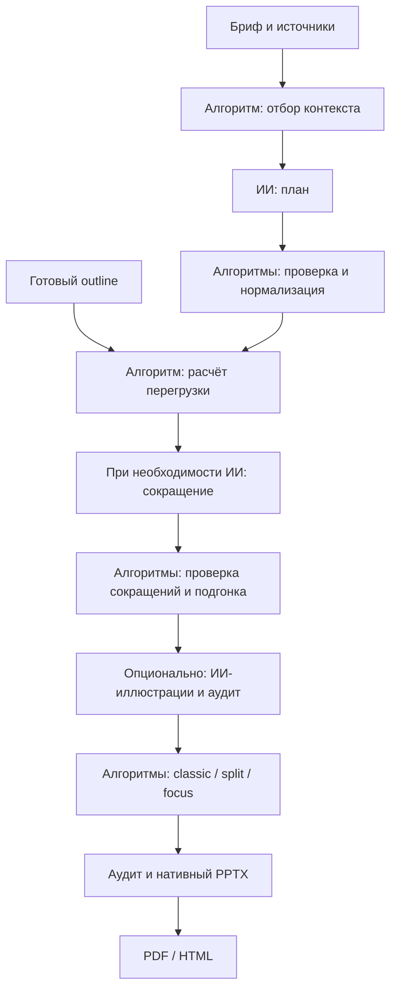

# Алгоритмы, ИИ и сборка презентации

Алгоритмические решения выполняются отдельными функциями. Модель предлагает содержание, а пайплайн проверяет ответ и передаёт один план в три варианта вёрстки. HTTP-обработчик отвечает за очередь, таймаут и сохранение состояния задания.

## Границы модулей

| Где | Ответственность |
| --- | --- |
| `backend/designer/algorithms/context.py` | Разбиение источников и отбор фрагментов в строгий общий лимит символов |
| `backend/designer/algorithms/content.py` | Типографика, числа, повторы, подписи и ограничения структуры |
| `backend/designer/algorithms/validation.py` | Проверка плана модели: источники, объём, язык, заголовки, диаграммы и числа |
| `backend/designer/algorithms/balance.py` | Расчёт перегрузки, проверка сокращений, подгонка и сохранение исходного текста |
| `backend/designer/layout.py`, `audit.py`, `assets.py` | Вёрстка, детерминированный аудит и подбор ассетов |
| `backend/designer/ai.py` | Транспорт к моделям, JSON-ответы и повтор запросов |
| `backend/designer/ai_audit.py`, `ai_assets.py` | Вызовы моделей для проверки содержания и изображений |
| `backend/designer/pipeline.py` | Последовательность алгоритмов, ИИ и сборки вариантов |
| `backend/designer/app.py` | HTTP, задания, хранилище и передача зависимостей пайплайну |
| `backend/designer/generation.py` | Совместимые импорты старых функций |

Тест `test_deterministic_modules_do_not_load_ai_transport` импортирует алгоритмы, аудит, вёрстку и библиотеку ассетов в отдельном процессе и проверяет, что ИИ-транспорт и HTTP-клиент не загружены.

## Последовательность



`run_generation` получает функции планирования, балансировки и рендера явно. Поэтому его можно запускать с настоящей моделью или проверять порядок этапов контролируемыми зависимостями. `app.run_job` ограничивает всё задание 300 секундами. Отмена прерывает пайплайн и не помечается успешным результатом.

Без модели можно передать `outline` в `POST /api/v1/generations`. Запрос без плана требует настроенного LLM. `GET /api/v1/templates` возвращает `llm_configured`; флаг не содержит адресов провайдера или ключей.

## Что исправлено

- Отбор контекста учитывает разделители и не добавляет неучтённые фрагменты после исчерпания бюджета. Идентификаторы источников сохраняются.
- Разбиение длинного абзаца не переставляет его части относительно предыдущего текста и завершается на строках без пробелов.
- Ответ сокращателя проверяется целиком до применения: допустимые уникальные индексы, текстовые поля, ограничения схемы и отсутствие новых чисел. Неудачный ответ не оставляет частично изменённый план.
- После ответа сокращателя повторно применяются правила типографики.
- При сокращении полный исходный текст слайда сохраняется в заметках PPTX. Если лимит заметок не позволяет сохранить его, исходный слайд остаётся целиком, а job получает предупреждение о необходимости разделения.
- У таблиц заданы внутренние отступы и межстрочный интервал: стандартные отступы Office больше не увеличивают строки за пределы рассчитанной рамки при конвертации в PDF.
- Длинное название единственного ряда не переносит весь заголовок слайда на ось диаграммы: ось сохраняет единицу измерения.

Проверка структуры и чисел не доказывает корректность всех перефразированных утверждений. Для этого остаются контекстный аудит и просмотр человеком. Недостаток исходных фактов может привести к меньшему количеству слайдов с предупреждением; пайплайн не дополняет материал выдуманными фактами ради числа страниц.

## Как повторить прогон с настоящей моделью

Настройте `DESIGNER_LLM_BASE_URL`, `DESIGNER_LLM_MODEL` и `DESIGNER_LLM_API_KEY` в окружении backend. Модель должна быть доступна у выбранного провайдера. Проверенный прогон использовал `gpt-oss-20b`; идентификатор модели зависит от провайдера.

Запустите backend с LibreOffice и шрифтами из `backend/designer/assets/fonts` — например, штатный Docker-образ. Затем:

```bash
python tools/make_samples.py http://127.0.0.1:8000 \
  --template /path/to/template.pptx \
  --source samples/source/материал-инициатива.md \
  --slide-count 8 --output output/pipeline-smoke
```

Команда загружает материалы и шаблон, вызывает серверную генерацию без готового плана, выполняет текстовый ИИ-аудит и сохраняет три оформления в PPTX, PDF и HTML вместе с отчётами. `--visual-audit` дополнительно требует настроенного VLM. Ключи читаются из окружения и не записываются в документацию.

## Проверка 17 октября 2026

Выполнен реальный прогон через API приложения и `gpt-oss-20b`: шаблон VK Tech, материал `samples/source/материал-инициатива.md`, 8 слайдов, текстовый ИИ-аудит. Генерация трёх вариантов заняла 115 секунд. Каждый PPTX открывается, содержит 8 слайдов и три нативные диаграммы; слайдов, целиком заменённых растром, нет. Смещённого брендинга проверка файла не обнаружила.

Автоматический аудит каждого варианта: 0 ошибок и 2 предупреждения о фоне обложки и финального слайда. При импорте шаблона LibreOffice ещё не был доступен, поэтому фон не был измерен; на слайдах применены подложки. Затем все варианты отдельно отрисованы в PDF с гарнитурой Play и экспортированы в HTML. Обнаруженные при просмотре выход таблицы и длинная подпись оси исправлены в экспортере и закреплены регрессиями.

Артефакты локального прогона находятся в `output/pipeline-live-2026-10-17/`; исходный шаблон организаторов и его копии в Git не добавляются.

Проверки:

```bash
PYTHONPATH=backend python -m pytest backend/tests -q
```

Для PowerShell сначала задайте `$env:PYTHONPATH = 'backend'`. `backend/tests/test_algorithm_boundaries.py` проверяет границы слоёв, бюджет контекста, сокращения, заметки, отмену и порядок этапов. `backend/tests/test_export_density.py` проверяет подпись оси и реальные координаты последней строки таблицы после конвертации LibreOffice.
